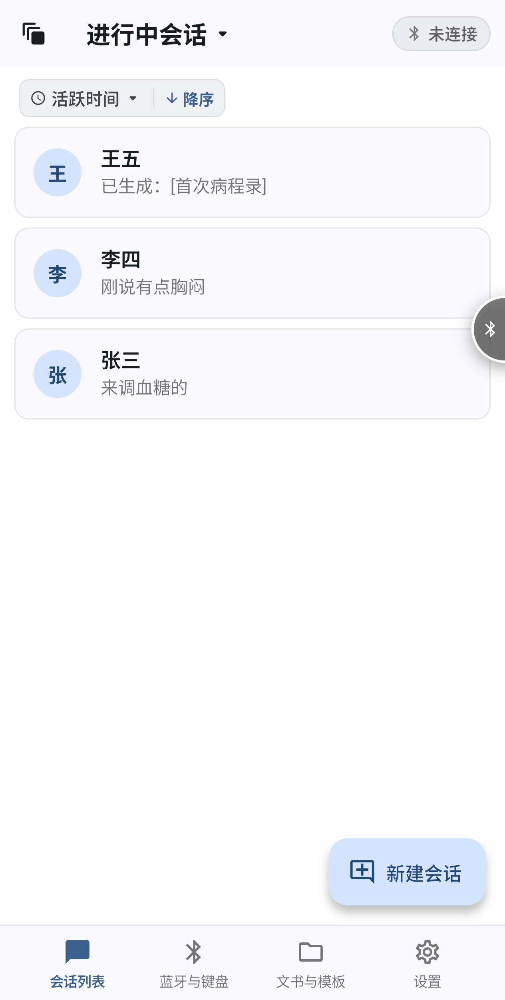
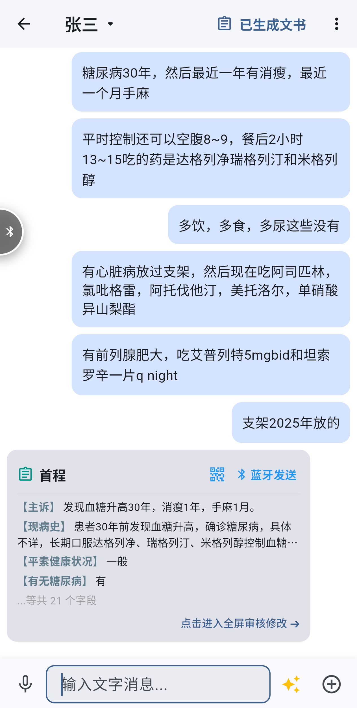
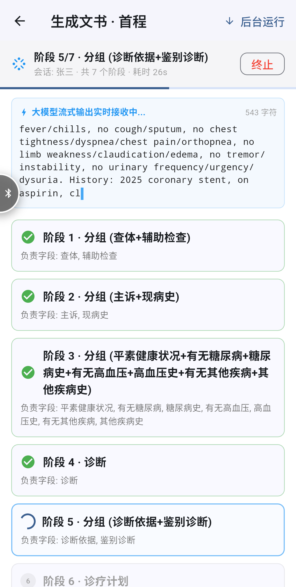

<div align="center">


# 小培同学 PeiPal

**说几句、拍几张，剩下的交给小培。**

<br>

<a href="https://github.com/xinggue/PeiPal_app/releases"></a>
<a href="https://github.com/xinggue/PeiPal_app/stargazers"></a>
<a href="https://github.com/xinggue/PeiPal_app/network/members"></a>
<a href="./LICENSE"></a>


<br>
<br>

<a href="https://github.com/xinggue/PeiPal_app/releases">下载</a> ｜
<a href="#快速开始">快速开始</a> ｜
<a href="#自行构建">自行构建</a> ｜
<a href="https://github.com/xinggue/PeiPal_app/issues">问题反馈</a> ｜
<a href="#配套项目">键盘与云端</a>

</div>

<br>

小培同学是一个**开源、免费**的全平台**聊天式结构化文书工作台**，基于 Flutter 构建。像给同事发消息一样，发送文字、语音和照片即可：语音自动转写，照片自动识别，随后小培严格遵循你给定的要求与参考示例，分阶段写出高可用的结构化文书。每个字段都可检查、修改，每次生成都有完整记录。

<br>

更有[配套的文书录入方案](https://github.com/xinggue/PeiPal_Keyboard)：**高速、稳定，无惧内网电脑环境**，一站式解决枯燥、重复的文书撰写与录入，真正解放双手。

<br>

软件内置开箱即用的病历结构、模板与术语库，但能力不止于病历。模板、字段、流程、标准目录均可自定义，法务、金融、保险、巡检、人事、科研同样适用。工号 2333 的小培同学，随时准备替你代劳。

<br>

---

<br>

## 主要页面

<br>

<table>
  <tr>
    <td align="center"><br><br><sub>主页面</sub></td>
    <td align="center"><br><br><sub>聊天采集</sub></td>
    <td align="center"><br><br><sub>文书生成</sub></td>
  </tr>
</table>

<br>

---

<br>

## 主要特点

<br>

- 🆓 **开源免费，全平台**：基于 Apache-2.0 协议开源，完全免费。支持 Android、iOS、macOS、Windows，手机与电脑体验一致。

<br>

- 💬 **沟通即工作，知晓即完工**：交互逻辑完全照搬微信，学习成本为零。把材料发给小培就是在工作；小培看过了，文书也就完成了。

<br>

- ⌨️ **高速、稳定、无惧内网的自动输入**：软硬件一站式解决，详见 [PeiPal_Keyboard](https://github.com/xinggue/PeiPal_Keyboard)。模拟键盘直接向电脑输入，目标电脑无需安装软件、无需联网，也不会出现 U 盘设备，内网环境照常使用。输入速度可调，自动绕开输入法、校正大小写与数字键盘状态，并逐条回执确认。没有硬件时，也可以用多包二维码配合扫码枪录入。

<br>

- 🧭 **精细、可控、符合习惯的文书生成**：给大语言模型一个好用的方向盘，一键生成高度可用的标准文书。按模板流程分阶段生成，可以指定写作指引与参考示例、挑选参与生成的材料，生成前还能预览完整提示词。

<br>

- 🧩 **强大、完善的模板系统**：字段类型、条件分支、流程图、输入动作全部可视化编辑。内容模板与标准词条库相互配合，内置 ICD-10 诊断库（3.8 万+ 条，支持拼音与模糊搜索），也可以创建自己的标准词条库。

<br>

- 🔍 **审阅、修改、追溯**：字段内联编辑，自动校验并提示问题，每次生成都留有完整日志。

<br>

- 🔑 **BYOK，自带密钥**：对话、识别、转写都使用你自己的服务，兼容接口均可接入。API Key 加密保存，记录存放在设备本地。

<br>

- 📦 **自由易用的导入导出与在线模板广场**：模板、词条库乃至全部数据都可以备份导出、恢复导入；也可以到在线模板广场分享和获取模板。

<br>

---

<br>

## 配套项目

<br>

| 项目 | 说明 | 地址 |
|---|---|---|
| 小培键盘 | ESP32 蓝牙键盘固件，把内容"打"进电脑，并支持扫码枪多包二维码输入 | [PeiPal_Keyboard](https://github.com/xinggue/PeiPal_Keyboard) |
| 在线模板广场 | 模板分享后端，支持 Cloudflare Workers 与单文件自托管 | TODO |

<br>

---

<br>

## 快速开始

<br>

1. 前往 [Releases](https://github.com/xinggue/PeiPal_app/releases)，下载适合你设备的安装包并安装。
2. 打开小培，上手步骤由 App 内置的引导带你完成。

> 想自己编译？见 [自行构建](#自行构建)。

<br>

---

<br>

## 自行构建

<br>

### 环境要求

- Flutter 3.44 及以上（Dart 3.12.2 及以上）
- 目标平台对应的工具链：Android 需要 Android SDK（minSdk 24），iOS / macOS 需要 Xcode，Windows 需要 Visual Studio（含"使用 C++ 的桌面开发"工作负载）

<br>

### 构建步骤

```bash
git clone https://github.com/xinggue/PeiPal_app.git
cd PeiPal_app

flutter pub get
flutter analyze        # 静态检查
flutter test           # 运行测试

flutter run -d <设备>  # 用 flutter devices 查看可用设备

flutter build apk      # Android，产物位于 build/app/outputs/flutter-apk/
flutter build ios      # iOS
flutter build macos    # macOS
flutter build windows  # Windows
```

> Android 的 release 构建目前使用调试签名，正式分发前请在 `android/app/build.gradle.kts` 中换成你自己的签名配置。

<br>

### 目录结构

```
lib/
├── core/          路由、主题、通用常量
├── data/          数据库、仓库、各类服务（蓝牙、识别、生成、二维码、备份……）
├── domain/        数据模型与生成流程的核心逻辑
├── presentation/  页面与组件
└── providers/     全局状态
assets/data/       内置 ICD-10 知识库
```

<br>

---

<br>

## 开源协议

<br>

本项目基于 [Apache License 2.0](./LICENSE) 开源。

<br>

---

<br>

## ⭐ Star History

<br>

> 如果小培帮你省下了时间，欢迎点个 Star，这是继续维护的最大动力。

<div align="center">

[](https://star-history.com/#xinggue/PeiPal_app&Date)

</div>

<br>

<div align="center">

_让重复的录入，交给工号 2333。_

</div>
